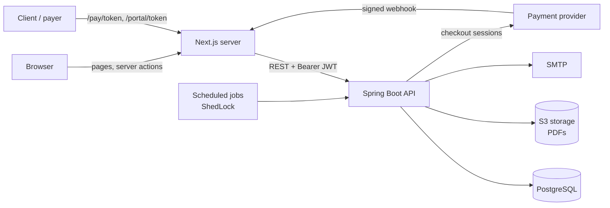
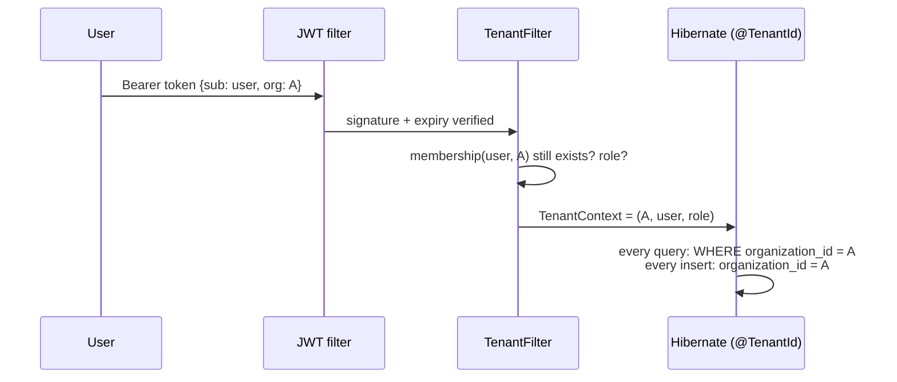
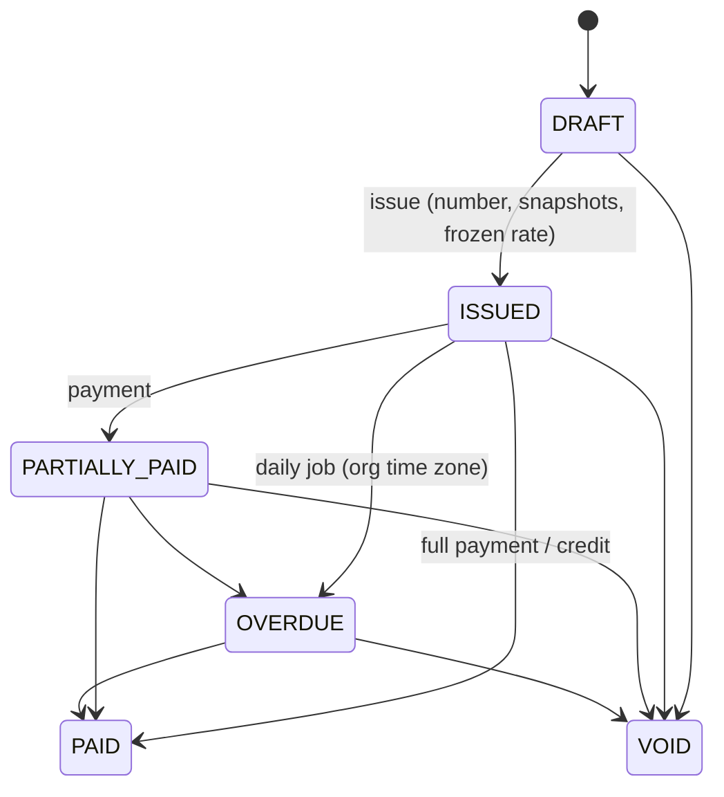
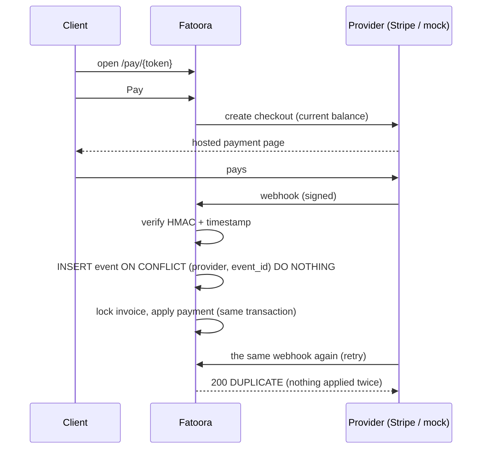

<div align="center">


# Fatoora · فاتورة

An invoicing app for small businesses in Jordan and the Gulf.

[](https://github.com/Qusayijrab/fatoora/actions/workflows/ci.yml)


<br />

<picture>
  <source media="(prefers-color-scheme: dark)" srcset="docs/screenshots/dashboard-dark.png" />
  
</picture>

</div>

---

## Why I built this

Most invoicing tools assume two decimal places and an English-only PDF. In Jordan the
dinar has **three** (1.250 JOD is a real price), clients expect Arabic on the invoice, and a lot
of businesses bill in JOD and USD at the same time.

So I built the tool I'd want if I ran a small studio in Amman: you add your clients, send a
quote, turn it into an invoice, email it as a bilingual PDF, and the client pays through a link.
If they don't pay, it reminds them for you.

It's a portfolio project, but I treated it like something real money would go through. Invoice
numbers can't skip or repeat, an issued invoice can't be quietly edited, one business can never
see another's data, and the same payment can't be counted twice. Each of those rules has tests
behind it.

## What you can do with it

- **Quotes that become invoices.** Send a quote, the client accepts it (or you mark it), and one
  click turns it into an invoice.
- **Proper invoice numbers.** `INV-2026-0001`, `INV-2026-0002`… in order, per business, given
  only when you issue. Drafts don't get a number.
- **No silent edits.** Once an invoice is issued it's locked. To fix a mistake you void it or
  issue a credit note, like an accountant would.
- **Get paid online.** Every invoice can have a private payment page. It works with Stripe, and
  there's a fake checkout for testing so you never need real card details.
- **Recurring invoices.** Rent, retainers, monthly subscriptions. It bills on schedule and handles
  months of different lengths (31 Jan, then 28 Feb, then 31 Mar).
- **Automatic reminders.** Pick the days (say 1, 7 and 14 days late) and it emails the client
  politely, in your own time zone.
- **Several currencies.** JOD, USD, SAR, AED, KWD and more, each with the right number of
  decimals. The exchange rate is saved on the day you issue, so old reports never shift.
- **A page for each client.** One private link where a client sees all their invoices and quotes,
  downloads PDFs, pays, or accepts a quote. They don't need an account.
- **A history you can trust.** Everything (created, issued, paid, voided) is logged with who did
  it and when. Nobody can edit or delete those entries, not even through the database.
- **Teams.** Invite your accountant or a partner as an admin or member, and run more than one
  business from the same login.

## Screenshots

<table>
  <tr>
    <td width="50%"><br /><sub><b>Invoices.</b> Filter by status, sort any column, tick a few and export them or email them all at once.</sub></td>
    <td width="50%"><br /><sub><b>One invoice.</b> On the left, what your client sees. On the right, what's still owed and what happened so far.</sub></td>
  </tr>
  <tr>
    <td><br /><sub><b>Writing an invoice.</b> Pick saved products or type lines by hand. Totals update as you type, down to the last fils.</sub></td>
    <td><br /><sub><b>The PDF.</b> English and Arabic side by side, with the Arabic shaped properly. <a href="docs/invoice-example.pdf">See a real one</a>.</sub></td>
  </tr>
  <tr>
    <td><br /><sub><b>The payment page.</b> What your client opens from the email. No login, just the invoice and a Pay button.</sub></td>
    <td><br /><sub><b>The client's page.</b> Everything one client has with you, behind one private link.</sub></td>
  </tr>
  <tr>
    <td><br /><sub><b>Audit log.</b> Every change, when it happened and who did it.</sub></td>
    <td><br /><sub><b>Home page.</b> You can click an example invoice through its whole life, from draft to paid.</sub></td>
  </tr>
</table>

<p align="center">
  
  &nbsp;
  
  &nbsp;
  
  <br /><sub>It works on a phone too, because that's where most clients open the payment link.</sub>
</p>

## Run it on your machine

You'll need **Java 21**, **Node 24 or newer**, and **Docker**.

```bash
# 1. Start the database, a fake email inbox, and file storage
cp infra/.env.example infra/.env
docker compose -f infra/docker-compose.yml up -d

# 2. Start the API (http://localhost:8080)
cd backend && ./mvnw spring-boot:run

# 3. Start the website (http://localhost:3000)
cd frontend && cp .env.example .env.local && npm install && npm run dev

# 4. Optional: fill it with a sample business so there's something to look at
cd frontend && npm run seed:demo
```

Step 4 creates **Nabati Design Studio**, a made-up design studio in Amman with six months of
clients, invoices (some paid, some late), quotes and a monthly retainer. It prints a login you
can use straight away.

A few other things you can open while it's running:

| | |
|---|---|
| Every email the app "sends" (nothing actually leaves your computer) | <http://localhost:8025> |
| The stored PDF files | <http://localhost:9001> |
| The API documentation, where you can try every endpoint | <http://localhost:8080/swagger-ui.html> |

Payments use the fake checkout by default, so you can click "Pay" as much as you like.

## How it's put together

| | |
|---|---|
| **Backend** | Java 21, Spring Boot 4.1, Spring Security with JWT, JPA / Hibernate 7, Flyway, PostgreSQL 16 |
| **Frontend** | Next.js 16 with Server Actions, TypeScript, Tailwind v4, shadcn/ui, TanStack Table |
| **PDFs** | HTML templates turned into PDF with OpenHTMLtoPDF, with an Arabic font built in |
| **Background jobs** | Spring Scheduler, with ShedLock so two servers never run the same job |
| **Payments** | A small `PaymentGateway` interface, with Stripe and a fake provider behind it |
| **Tests** | JUnit 5 with Testcontainers (a real Postgres, not a mock), Playwright for the browser |



A couple of choices I made on purpose:

- **The browser never talks to the API directly.** The login token lives in a cookie that page
  scripts can't read, and only the Next.js server uses it. Even if someone managed to inject
  JavaScript into a page, they couldn't steal it.
- **Public links use long random codes,** not `invoice/42`. You can't guess your way to someone
  else's invoice by changing a number.

## The parts that took the most thought

### Money

Money is never stored as a decimal number, because `0.1 + 0.2` isn't `0.3` in most programming
languages. Every amount is a whole number of the smallest unit (fils, cents) plus its currency,
wrapped in a `Money` class that knows JOD has 3 decimals, USD has 2 and JPY has 0. If you type
`1.005` for a USD price, it's rejected instead of being rounded behind your back. Tax is
rounded on each line, the way it's printed, so the totals always add up on paper.

### Keeping businesses apart

Every table has an `organization_id`, and the app only ever takes it from your signed login
token, never from the URL. Rather than remembering to add a filter to every query, Hibernate
adds it automatically, so there's no query that can forget. The tests create two businesses and
check that the first can't read, change, pay, email or download anything belonging to the
second.



### The life of an invoice

An invoice can only move in certain directions. You can't pay a draft, and you can't un-void
something. Those rules live in one table inside the `Invoice` class, not scattered across
buttons and controllers.



Invoice numbers come from a single database statement that bumps a counter and returns it in
one go. To check it, one test issues 20 invoices from 10 threads at the same time and makes sure
it gets exactly 0001 to 0020, with no gaps and no duplicates.

### Payments

Payment providers retry their notifications, sometimes several times. Each notification is saved
with its ID first, so if the same one arrives again it's simply ignored and the client isn't
marked as paying twice. The signature is checked before anything else happens.



Adding a local provider like Tap, PayTabs or HyperPay would mean writing one new class.

### Jobs that never run twice

Recurring invoices and reminders each claim their slot in the database first ("March for this
template", "day 7 for this invoice"). If the server crashes halfway, or two servers run the job
at once, the second attempt finds the slot taken and does nothing. Nobody gets billed or emailed
twice.

### Exchange rates

When you issue a USD invoice in a JOD business, the rate of that day is saved on the invoice.
Reports use that saved rate forever, so last year's numbers don't change when the dollar moves.
If no rate is available, issuing is refused rather than guessed.

## Tests

```bash
cd backend && ./mvnw verify        # about 195 tests, on a real Postgres in Docker
cd frontend && npm run e2e         # browser tests with Playwright (the API must be running)
```

They cover the things I'd be most worried about in production: rounding and decimals, the
invoice rules, numbering under load, businesses not seeing each other's data, the Arabic in the
PDF, emails actually arriving, forged or repeated payment notifications, and jobs running twice.
GitHub Actions runs all of it on every push.

## Putting it online

```bash
cp infra/.env.prod.example infra/.env.prod   # then fill in real passwords and keys
docker compose -f infra/docker-compose.prod.yml --env-file infra/.env.prod up -d --build
```

Only the website (port 3000) is exposed; it passes payment notifications through to the API.
Put HTTPS in front of it.

## What's in the folders

```
backend/     the Spring Boot API, plus the database migrations
frontend/    the Next.js website, browser tests, and the demo data script
infra/       Docker setup for running locally and in production
docs/        the screenshots and an example PDF
```

If you're curious about the look and feel, the design notes are in
[`frontend/DESIGN.md`](frontend/DESIGN.md).

## What I'd add next

- A late-payment risk score that flags clients who usually pay late
- Arabic for the whole interface, not just the PDFs
- Local payment providers (Tap, PayTabs, HyperPay)
- E-invoicing formats required by tax authorities in the region

## License

[MIT](LICENSE). Use it, learn from it, build on it.
