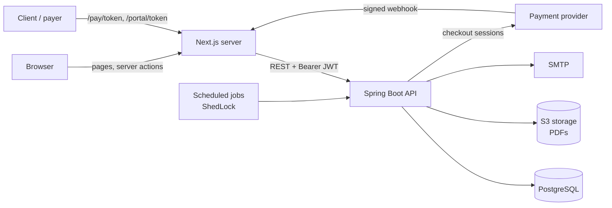
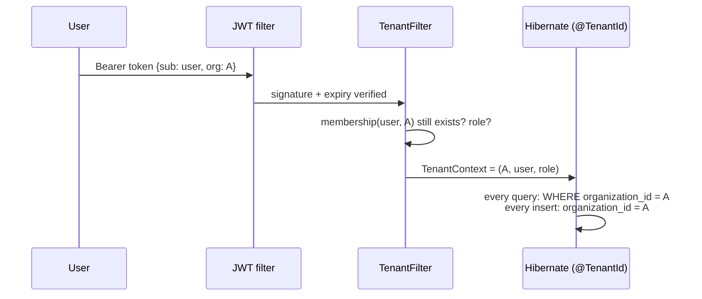
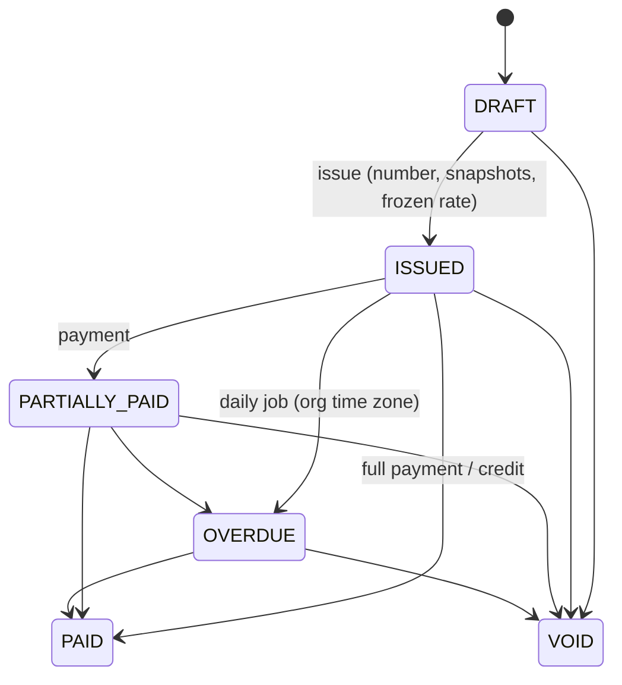
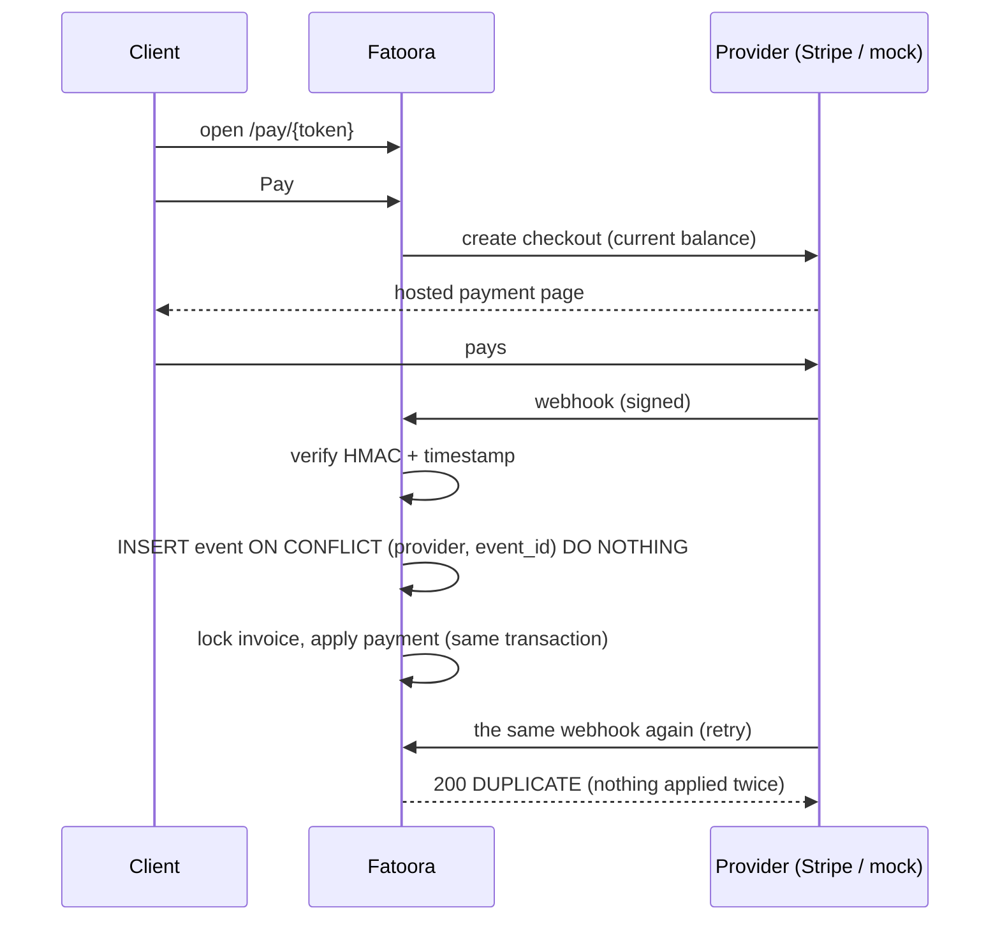

<div align="center">


# Fatoora · فاتورة

**Quotes, invoices, payment links and reminders for small businesses in Jordan and the Gulf.**
Dinars to three decimals, Arabic on every PDF, and every step kept on the record.

[](https://github.com/Qusayijrab/fatoora/actions/workflows/ci.yml)


<br />

<picture>
  <source media="(prefers-color-scheme: dark)" srcset="docs/screenshots/dashboard-dark.png" />
  
</picture>

</div>

---

## What it does

A multi-tenant SaaS where a business manages clients and products, sends quotes, issues
invoices as bilingual PDFs, gets paid online through a payment link, bills retainers on a
schedule, and chases late payers automatically. Built as a portfolio project, with the
correctness a real invoicing system needs, each rule proven by tests.

| | |
|---|---|
| 🧾 **Quotes → invoices** | Draft, send, accept (by you or by the client in their portal), convert to an invoice in one click. |
| 🔢 **Gapless numbering** | `INV-2026-0001`, sequential per organization and year, assigned only on issue, safe under concurrency. |
| 🔒 **Immutable once issued** | Corrections are a void (keeps its number) or a credit note `CN-2026-0001`. Client and seller details are frozen onto the document. |
| 💳 **Payment links** | A private `/pay/…` page per invoice. Stripe Checkout or a built-in test provider; signed, de-duplicated webhooks. |
| 🔁 **Recurring invoices** | "Every month on the 31st" done right (31 Jan → 28 Feb → 31 Mar), each period billed exactly once. |
| ⏰ **Overdue reminders** | Polite emails at the days you choose (1, 7, 14…), in each organization's own time zone. |
| 💱 **Multi-currency** | JOD, USD, SAR, AED, KWD and more, each with its ISO decimals. The exchange rate is frozen at issue. |
| 🌐 **Client portal** | One link per client: every invoice and quote, PDFs, pay, accept or decline. No account needed. |
| 📜 **Audit log** | Append-only. Every create, issue, payment, void and change, with who did it. The database refuses edits. |
| 👥 **Teams** | Several organizations per user, owners, admins and members, switch with one click. |

## Screenshots

<table>
  <tr>
    <td width="50%"><br /><sub><b>Invoices</b>: filter by status, sort exactly, select rows to export CSV or email them.</sub></td>
    <td width="50%"><br /><sub><b>An invoice</b>: the document as the client sees it, with balance, payments and history.</sub></td>
  </tr>
  <tr>
    <td><br /><sub><b>Editor</b>: products or free lines, tax per line, totals previewed to the fils.</sub></td>
    <td><br /><sub><b>The PDF</b>: English and Arabic, shaped correctly, with the state stamped on it. <a href="docs/invoice-example.pdf">Open the example</a>.</sub></td>
  </tr>
  <tr>
    <td><br /><sub><b>Payment link</b>: what the client opens. No login, one invoice, one button.</sub></td>
    <td><br /><sub><b>Client portal</b>: everything one client has with you, in one private link.</sub></td>
  </tr>
  <tr>
    <td><br /><sub><b>Audit log</b>: what happened, when and by whom. Read-only by design.</sub></td>
    <td><br /><sub><b>Landing page</b>: walk an example invoice from draft to paid.</sub></td>
  </tr>
</table>

<p align="center">
  
  &nbsp;
  
  &nbsp;
  
  <br /><sub>On a phone: invoices become cards, the editor stacks each line, and clients pay in a tap.</sub>
</p>

## Try it locally

You need **Java 21**, **Node 24+** and **Docker**.

```bash
# 1. Database, email catcher and file storage
cp infra/.env.example infra/.env
docker compose -f infra/docker-compose.yml up -d

# 2. The API on :8080 (Swagger UI at http://localhost:8080/swagger-ui.html)
cd backend && ./mvnw spring-boot:run

# 3. The web app on :3000
cd frontend && cp .env.example .env.local && npm install && npm run dev

# 4. Optional: a demo business with six months of history
cd frontend && npm run seed:demo
```

The seed prints a login for **Nabati Design Studio**: clients, products, paid, part-paid and
overdue invoices, quotes and a monthly retainer. Then open:

| | |
|---|---|
| App | <http://localhost:3000> |
| Sent emails (nothing leaves your machine) | <http://localhost:8025> (Mailpit) |
| Stored PDFs | <http://localhost:9001> (S3 console) |
| API docs | <http://localhost:8080/swagger-ui.html> |

Payments use the built-in test checkout by default: no keys, no real money, but real signed
webhooks through the same code path Stripe uses.

## How it is built

| | |
|---|---|
| **Backend** | Java 21, Spring Boot 4.1, Spring Security (JWT), Spring Data JPA / Hibernate 7, Flyway, PostgreSQL 16 |
| **Frontend** | Next.js 16 (App Router, Server Actions), TypeScript, Tailwind v4, shadcn/ui, TanStack Table |
| **Documents** | Thymeleaf → OpenHTMLtoPDF with ICU bidi and Arabic shaping, embedded Tajawal font, S3 storage |
| **Jobs** | Spring Scheduler + ShedLock (one instance at a time) |
| **Payments** | `PaymentGateway` interface: Stripe Checkout adapter and a mock provider |
| **Tests** | JUnit 5 + Testcontainers (real Postgres and Mailpit), Playwright end to end |
| **Delivery** | Docker images, production compose, GitHub Actions |



- **The browser never calls the API.** The JWT sits in an httpOnly cookie and only Next.js
  server code uses it, so a script injected into the page cannot steal it.
- **Public pages carry a 256-bit random token** instead of a login, never a sequential id.
- The backend is organized by feature: `auth`, `organization`, `client`, `product`, `tax`,
  `quote`, `invoice`, `payment`, `recurring`, `jobs`, `currency`, `portal`, `audit`, `pdf`,
  `mail`, `common`.

## The rules that make it trustworthy

### Money is never a float

Stored as `amount_minor BIGINT` + `currency CHAR(3)` behind a `Money` value object that knows
each currency's ISO 4217 decimals (**JOD, KWD, BHD and OMR have 3**, USD 2, JPY 0).
`"1.005 USD"` is rejected, not rounded. Tax is rounded **per line**, half up, and totals are
sums of rounded lines. Amounts travel as strings (`"1250.500"`), and the editor previews them
with exact `BigInt` math.

### Every query is scoped to one organization, in one place



The organization comes **only** from the signed token, never from the URL or the body.
Entities extend `TenantScopedEntity` (`@TenantId`), so Hibernate adds the filter to every
query; nobody can forget a `WHERE`. Membership is re-checked on every request, so removing
someone takes effect immediately. Tests register two companies and prove A cannot read,
change, pay, email, download or link anything of B's.

### Documents move through a state machine, in the domain



Quotes follow `DRAFT → SENT → ACCEPTED | REJECTED | EXPIRED`, and an accepted quote converts
once. Transitions live in `Invoice` and `Quote` (one table each), never in controllers.
Numbers come from a single atomic `INSERT … ON CONFLICT DO UPDATE … RETURNING`; a test issues
20 invoices from 10 threads at once and gets exactly 0001–0020.

### Payments and webhooks are idempotent



Adding Tap, PayTabs or HyperPay is one class behind `PaymentGateway`. Stripe charges
three-decimal currencies in 10-fils steps, so such amounts are refused up front.

### Jobs never run twice

Recurring periods are claimed with a unique `(template, period)` row, and reminders with
`(invoice, day)`, so reruns, crashes and two racing instances never bill or email twice. A
start date in the past never back-bills. Overdue marking and quote expiry use each
organization's own midnight.

### Exchange rates are frozen

Issuing a USD invoice in a JOD company freezes `1 USD = 0.709 JOD` and its base total, and
reports use those values forever. Rates come from the organization's own rates, then the
official USD pegs (JOD, SAR, AED, QAR, BHD, OMR), then ECB reference rates. With none,
issuing is refused rather than guessed.

## Tests

```bash
cd backend && ./mvnw verify        # ~195 unit + integration tests on real Postgres (Docker required)
cd frontend && npm run e2e         # Playwright, with the API running on :8080
```

Highlights: currency decimals and rounding, state-machine tables, immutability, 20-thread
numbering, tenant isolation for every feature, PDF text and embedded Arabic font, real SMTP
through Mailpit, webhook signatures, replays and duplicates, job idempotency including two
racing runs, time-zone-correct overdue marking, frozen exchange rates. CI runs all of it, plus
lint, typecheck, a production build and both Docker images, on every push.

## Deploy

```bash
cp infra/.env.prod.example infra/.env.prod   # fill in real secrets
docker compose -f infra/docker-compose.prod.yml --env-file infra/.env.prod up -d --build
```

Only the web app (port 3000) is exposed. It forwards provider webhooks
(`/api/v1/webhooks/{provider}`) to the API. Put a TLS proxy in front.

## Project layout

```
backend/     Spring Boot API (com.fatoora.invoicing), Flyway migrations V1–V6
frontend/    Next.js app: (auth), (app) workspace, /pay and /portal public pages, e2e/
             scripts/seed-demo.mjs creates the demo business
infra/       docker-compose for development and production
docs/        screenshots and an example PDF
```

Design notes for the interface live in [`frontend/DESIGN.md`](frontend/DESIGN.md).

## License

[MIT](LICENSE)
