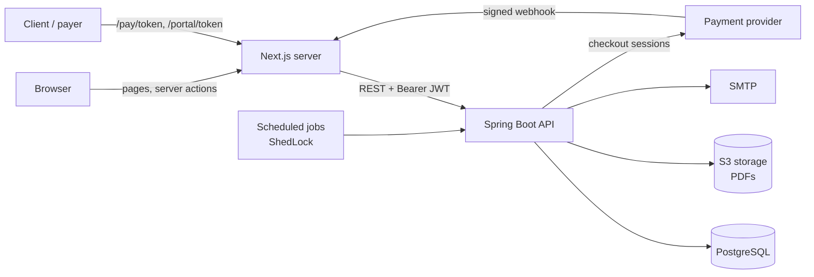
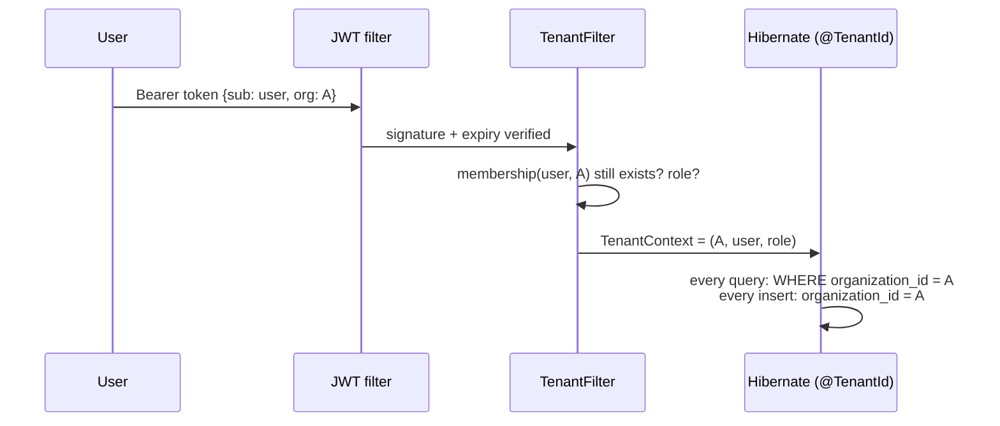
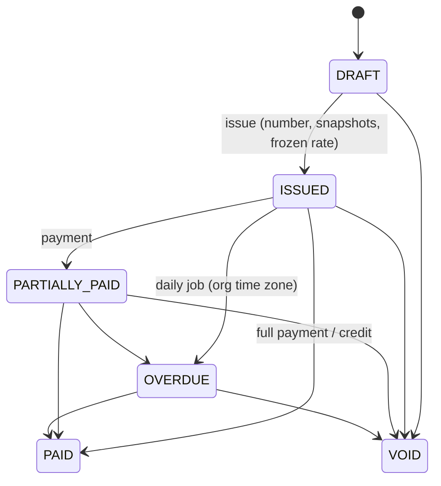
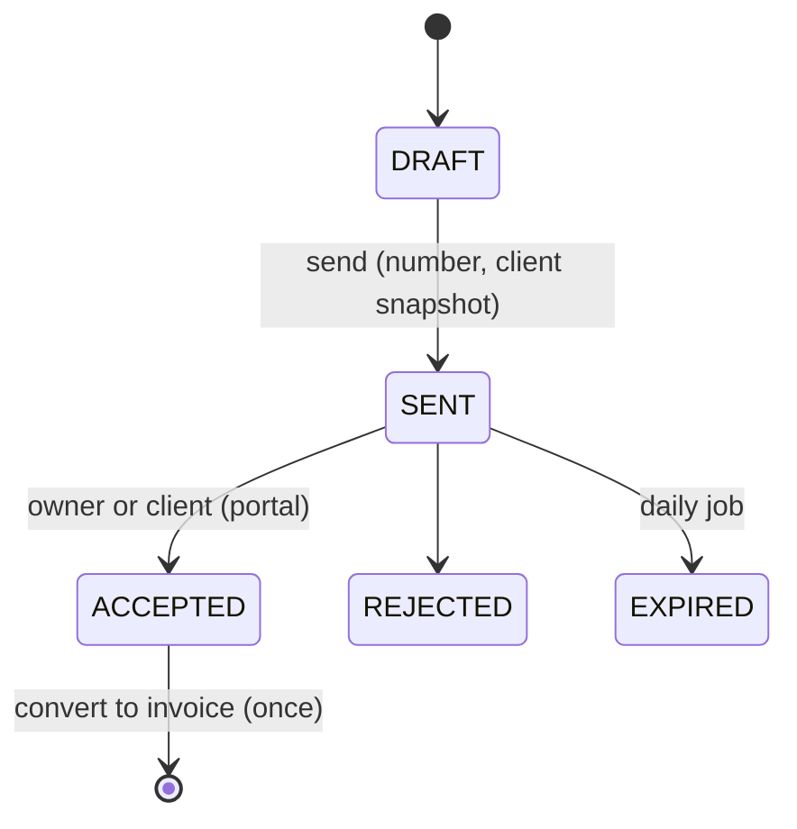
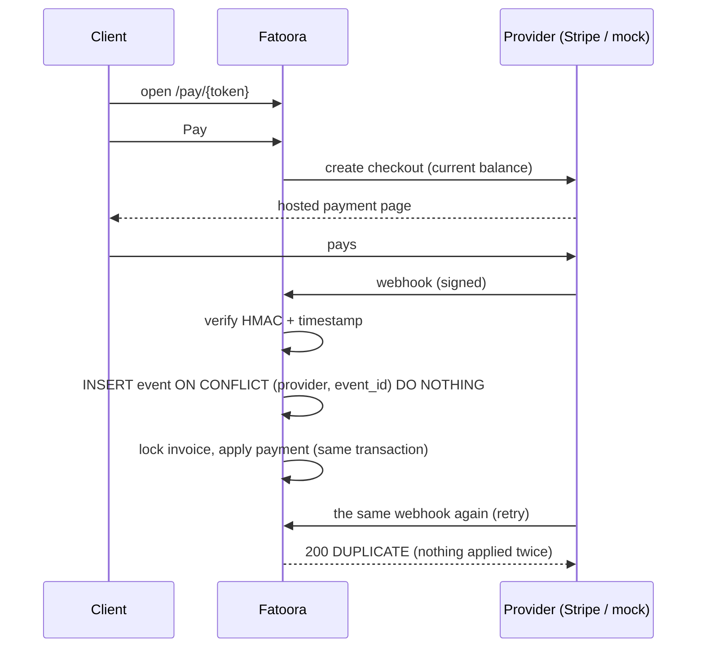

# Fatoora · فاتورة

Multi-tenant invoicing for small businesses in Jordan and the Gulf: clients, products,
quotes, invoices with Arabic-ready PDFs, email delivery, online payment links, recurring
invoices, overdue reminders, multi-currency reporting and a client portal.

Built as a portfolio project, with the correctness a real invoicing system needs:
exact money, gapless numbering, immutable issued documents, tenant isolation, frozen
exchange rates, idempotent jobs and webhooks, and an append-only audit log, each proven
by tests.

| | |
|---|---|
| **Backend** | Java 21, Spring Boot 4.1, Spring Security (JWT), Spring Data JPA / Hibernate 7, Flyway, PostgreSQL 16 |
| **Frontend** | Next.js 16 (App Router, Cache Components), TypeScript, Tailwind v4, shadcn/ui |
| **Documents** | OpenHTMLtoPDF with ICU bidi + Arabic shaping, embedded Tajawal font; S3-compatible storage |
| **Jobs** | Spring Scheduler + ShedLock |
| **Payments** | `PaymentGateway` interface: Stripe Checkout adapter + a built-in mock provider |
| **Tests** | JUnit 5 + Testcontainers (real Postgres and Mailpit), Playwright end-to-end |

---

## Architecture



- The browser **never talks to the API directly**. The JWT lives in an httpOnly cookie;
  Next.js server code calls the API with it. An XSS bug cannot steal the token.
- Public pages (payment links, client portal) carry a **256-bit random token** instead of
  a login. Webhooks carry a **provider signature**.
- The backend is organized by feature: `auth`, `organization`, `client`, `product`,
  `tax`, `quote`, `invoice`, `payment`, `recurring`, `jobs`, `currency`, `portal`,
  `audit`, `pdf`, `mail`, `common`.

## Multi-tenancy

Every business table has `organization_id`. The organization a request works in comes
**only** from the signed token, never from the URL or body.



- One central place: entities extend `TenantScopedEntity` (`@TenantId`), so Hibernate
  adds the filter to every query and load. Nobody can forget a `WHERE`.
- Membership is re-checked on every request: removing someone (or changing their role)
  takes effect immediately, not when their token expires.
- Tests register two companies and prove A cannot read, change, pay, email, download or
  link anything of B's (`TenancyIsolationIntegrationTest` and one isolation test per feature).

## Money

- Stored as `amount_minor BIGINT` + `currency CHAR(3)`; never `float`/`double`.
- A `Money` value object knows each currency's ISO 4217 decimals: **JOD, KWD, BHD, OMR
  have 3**, USD/SAR/AED 2, JPY 0. `"1.005 USD"` is rejected, not rounded.
- Line subtotal = price × quantity, **tax rounded per line**, HALF_UP; document totals
  are sums of rounded lines. The editor previews this with exact BigInt math.
- Amounts travel as decimal strings (`"1250.500"`), never JS numbers.

## Invoice and quote lifecycles

Enforced in the domain (`Invoice`, `Quote`), from one transition table each, never in controllers.





- **Immutable once issued.** Corrections are a **void** (keeps its number) or a
  **credit note** (`CN-2026-0001`) that reduces the balance.
- **Numbers** `INV-2026-0001` are sequential per organization and year, assigned only on
  issue, from one atomic `INSERT … ON CONFLICT DO UPDATE … RETURNING`. A test issues 20
  invoices from 10 threads at once and gets exactly 0001–0020.
- Client and seller details are **snapshotted** onto the document at issue.

## Payments and webhooks



- Providers sit behind `PaymentGateway`; adding Tap, PayTabs or HyperPay is one class.
- Stripe charges JOD/KWD/BHD/OMR in 10-fils steps; such amounts are refused up front.
- The mock provider (default in development) sends real signed webhooks through the same pipeline.

## Jobs

Hourly (each organization has its own midnight), one instance at a time via ShedLock:

- **Recurring invoices**: run dates computed from the anchor (31 Jan → 28 Feb → 31 Mar),
  each period claimed with a unique `(template, period)` row: reruns, crashes and racing
  instances never create a duplicate. A start date in the past never back-bills.
- **Overdue marking** and **quote expiry**, in the organization's time zone.
- **Reminders** at configurable days late, each `(invoice, day)` sent once; the claim is
  released if SMTP fails so the next run retries.

## Multi-currency

Issuing a foreign-currency invoice freezes `1 USD = 0.709 JOD` and its base total.
Reports use those frozen values forever. Rates come from: the organization's own rates →
official USD pegs (JOD, SAR, AED, QAR, BHD, OMR) → ECB reference rates. With none, issuing
is refused rather than guessing.

## Run it locally

Requirements: Java 21, Node 24+, Docker.

```bash
cp infra/.env.example infra/.env
docker compose -f infra/docker-compose.yml up -d     # postgres, mailpit, s3
cd backend && ./mvnw spring-boot:run                  # API on :8080, Swagger at /swagger-ui.html
cd frontend && cp .env.example .env.local && npm install && npm run dev   # app on :3000
```

- Emails: <http://localhost:8025> (Mailpit catches everything).
- Payments: the built-in test checkout; no real money moves.

## Tests

```bash
cd backend && ./mvnw verify        # ~194 unit + integration tests (Docker required)
cd frontend && npm run e2e         # Playwright (backend running on :8080)
```

Highlights: money rounding and currency decimals, state-machine tables, immutability,
20-thread numbering, tenant isolation per feature, PDF text and embedded Arabic font,
real SMTP delivery via Mailpit, webhook signatures/replays/duplicates, job idempotency
including two racing job runs, time-zone-correct overdue marking, frozen exchange rates.

## Deploy

```bash
cp infra/.env.prod.example infra/.env.prod   # fill in real secrets
docker compose -f infra/docker-compose.prod.yml --env-file infra/.env.prod up -d --build
```

Only the web app (port 3000) is exposed; it forwards provider webhooks
(`/api/v1/webhooks/{provider}`) to the API. Put a TLS proxy in front. CI (GitHub Actions)
runs backend tests, frontend lint/typecheck/build, Playwright against the real stack, and
builds both Docker images.

## Project layout

```
backend/    Spring Boot API (package com.fatoora.invoicing), Flyway migrations V1–V6
frontend/   Next.js app: (auth), (app) workspace, /pay and /portal public pages, e2e/
infra/      docker-compose for development and production
```
