<div align="center">


# Fatoora · فاتورة

An invoicing app for small businesses in Jordan and the Gulf.

[](https://github.com/Qusayijrab/fatoora/actions/workflows/ci.yml)


<br />

<picture>
  <source media="(prefers-color-scheme: dark)" srcset="docs/screenshots/dashboard-dark.png" />
  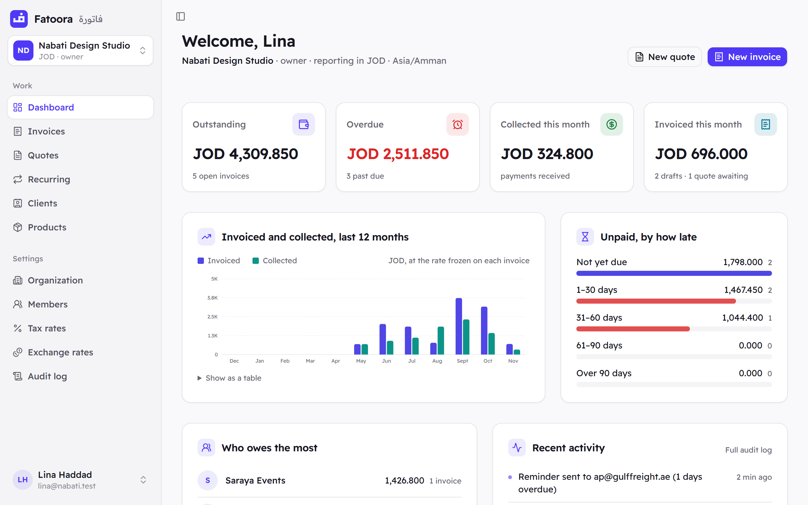
</picture>

</div>

## About

Fatoora helps a small business send quotes and invoices and get paid.

I built it for the way business works in Jordan and the Gulf. The dinar has three decimals
(1.250 JOD is a real price), clients expect Arabic on the invoice, and many businesses bill in
more than one currency.

It's a portfolio project, but I built it to handle real money safely. Invoice numbers never
skip or repeat, an issued invoice can't be changed, one business can never see another
business's data, and a payment is never counted twice.

## Features

- **Quotes**: send a quote, and turn it into an invoice with one click once it's accepted.
- **Invoices**: numbered in order (`INV-2026-0001`, `INV-2026-0002`…) and locked once issued.
  Mistakes are fixed with a void or a credit note.
- **PDFs in English and Arabic**: every invoice and quote, ready to email or download.
- **Online payments**: each invoice gets a private payment page. Works with Stripe, and has a
  test mode that needs no card.
- **Recurring invoices**: for rent, retainers and subscriptions. They're created on schedule.
- **Reminders**: late clients get a polite email on the days you choose.
- **Many currencies**: JOD, USD, SAR, AED, KWD and more, each with the right decimals.
- **Client page**: each client gets one private link to see, download and pay their invoices.
- **History**: every action is recorded with who did it and when, and can't be edited.
- **Teams**: invite people as admins or members, and run more than one business.

## Screenshots

<table>
  <tr>
    <td width="50%">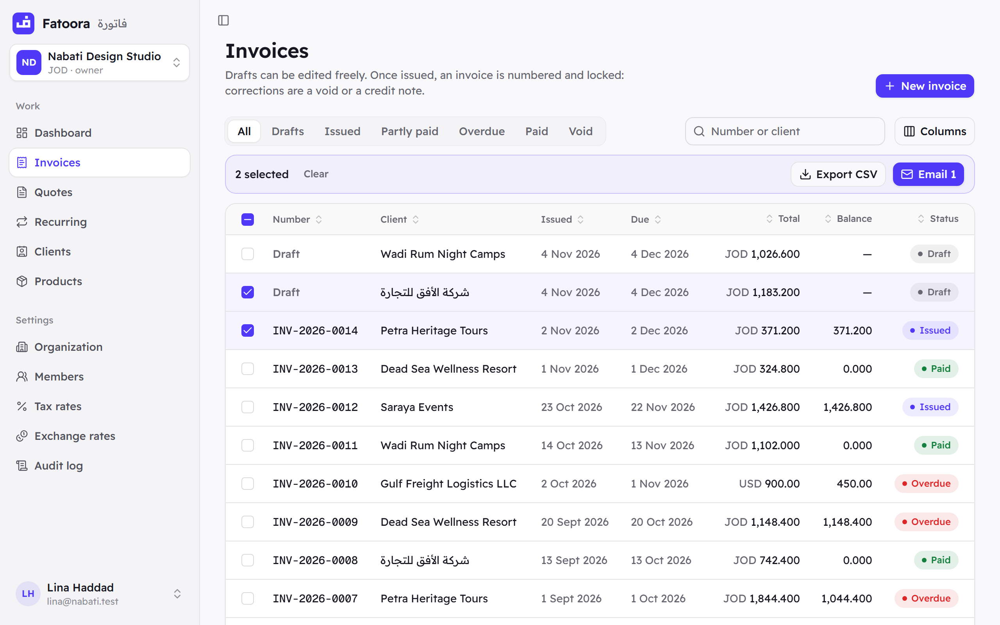<br /><sub><b>Invoices</b>: filter, sort, and export or email several at once.</sub></td>
    <td width="50%">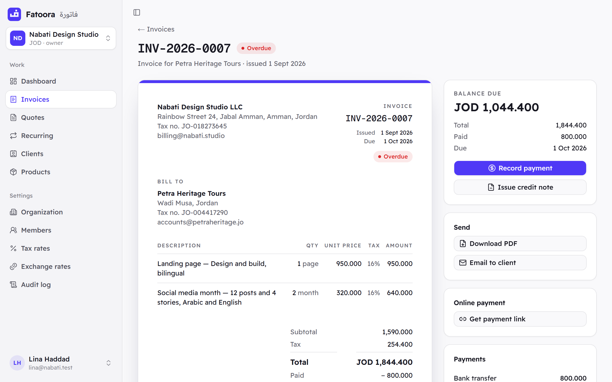<br /><sub><b>One invoice</b>: the document, what's still owed, and its history.</sub></td>
  </tr>
  <tr>
    <td>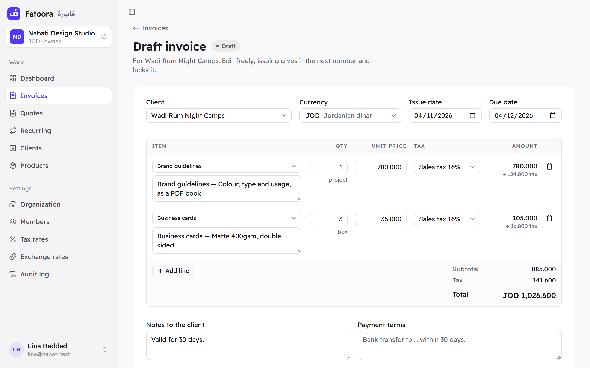<br /><sub><b>Writing an invoice</b>: totals update as you type.</sub></td>
    <td>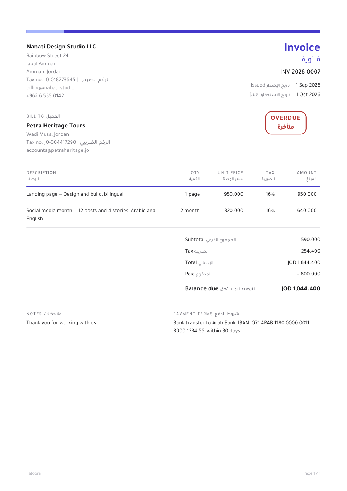<br /><sub><b>The PDF</b>: English and Arabic. <a href="docs/invoice-example.pdf">Open an example</a>.</sub></td>
  </tr>
  <tr>
    <td>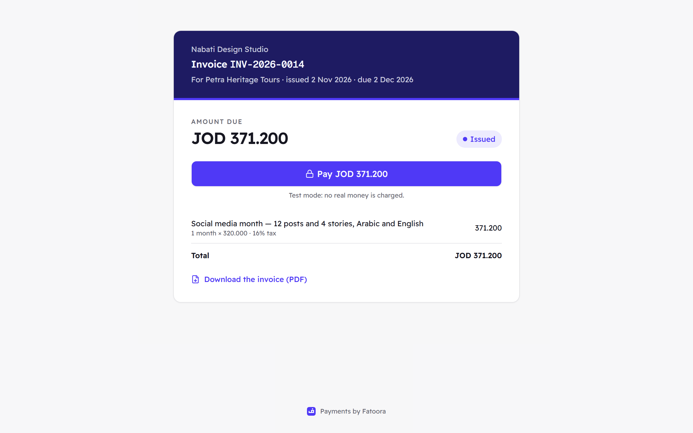<br /><sub><b>Payment page</b>: what the client sees. No login needed.</sub></td>
    <td>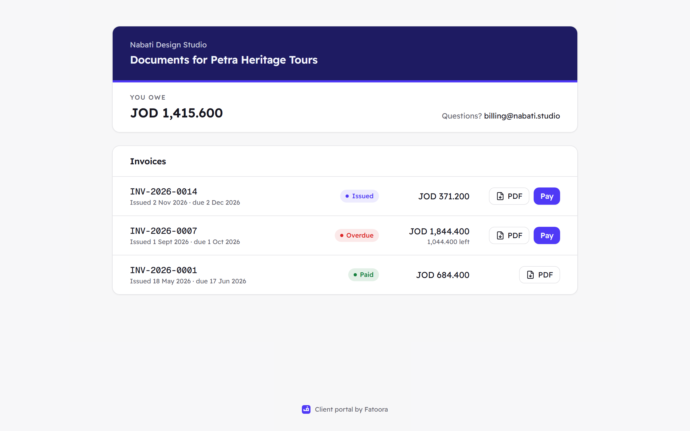<br /><sub><b>Client page</b>: all of one client's invoices in one place.</sub></td>
  </tr>
  <tr>
    <td>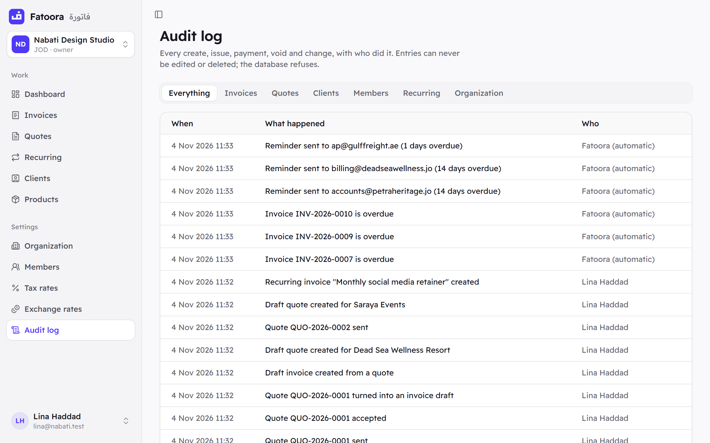<br /><sub><b>History</b>: who did what, and when.</sub></td>
    <td>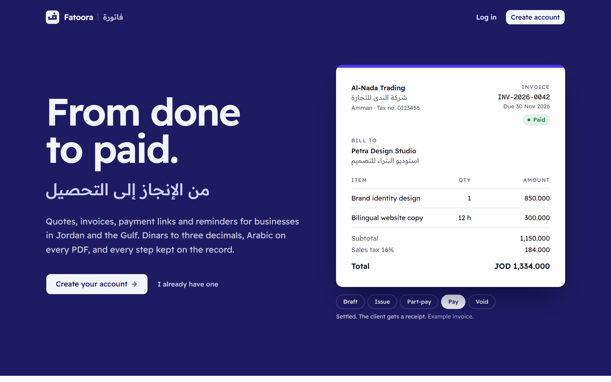<br /><sub><b>Home page</b>: click through an example invoice.</sub></td>
  </tr>
</table>

<p align="center">
  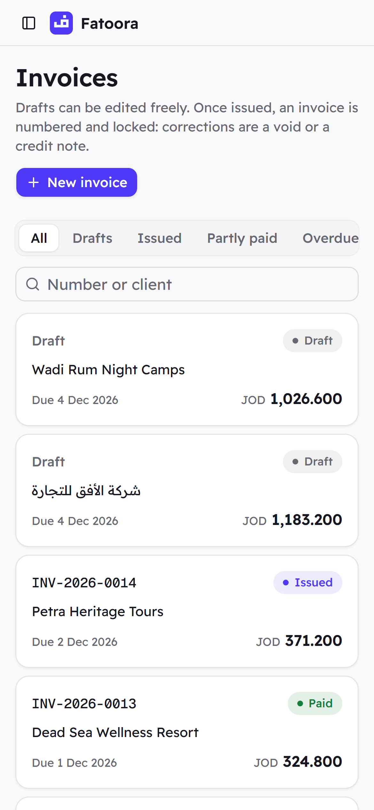
  &nbsp;
  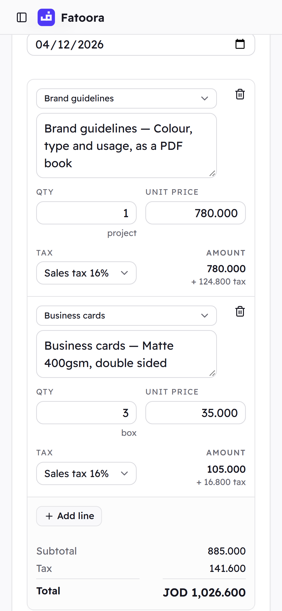
  &nbsp;
  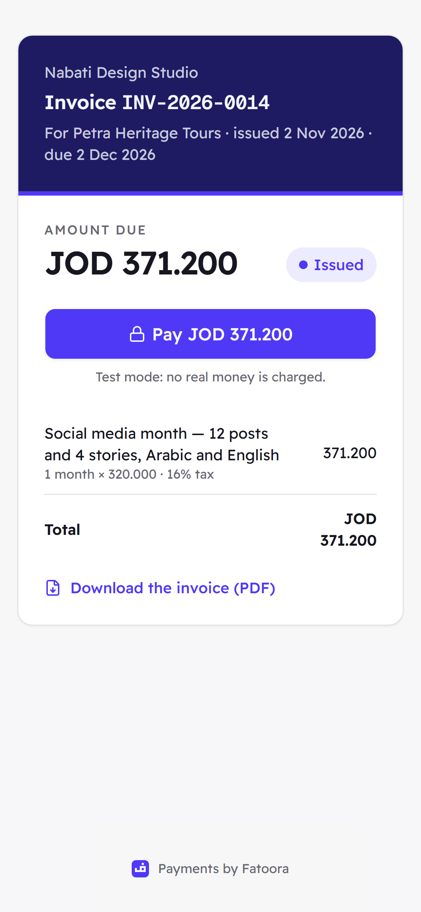
  <br /><sub>It works on phones too.</sub>
</p>

## Run it on your computer

You need **Java 21**, **Node 24** or newer, and **Docker**.

```bash
# 1. Start the database, email inbox and file storage
cp infra/.env.example infra/.env
docker compose -f infra/docker-compose.yml up -d

# 2. Start the API (the "dev" profile turns on the test payment provider)
cd backend && ./mvnw spring-boot:run

# 3. Start the website (in a new terminal)
cd frontend && cp .env.example .env.local && npm install && npm run dev

# 4. Optional: add a sample business to explore (in a new terminal)
cd frontend && npm run seed:demo
```

Step 4 creates a sample design studio with six months of clients, invoices and quotes, and
prints a login you can use.

When it's running, open these in your browser. They only work on your own computer:

| Address | What's there |
|---|---|
| `localhost:3000` | The app |
| `localhost:8025` | Emails the app sends (they never leave your computer) |
| `localhost:9001` | Stored PDF files |
| `localhost:8080/swagger-ui.html` | API documentation |

Payments run in test mode, so no real money is ever charged.

## Built with

| | |
|---|---|
| **Backend** | Java 21, Spring Boot 4.1, Spring Security, PostgreSQL 16, Flyway |
| **Frontend** | Next.js 16, TypeScript, Tailwind CSS, shadcn/ui |
| **PDFs** | OpenHTMLtoPDF, with an Arabic font included |
| **Payments** | Stripe, plus a test provider |
| **Tests** | JUnit 5, Testcontainers, Playwright |
| **Deployment** | Docker, GitHub Actions |

## How it works

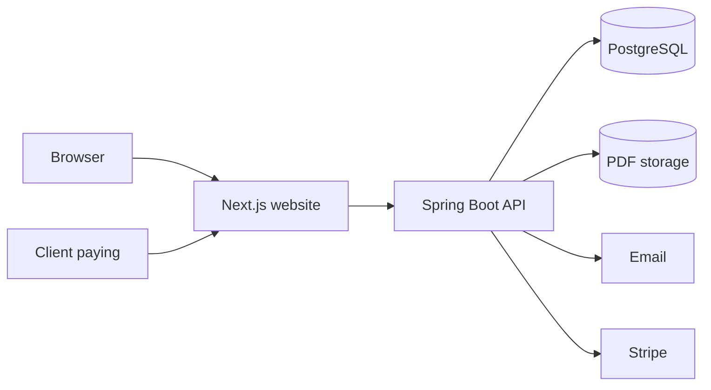

The browser only talks to the website. The website talks to the API, which does the work and
keeps the data.

An invoice moves through these steps:

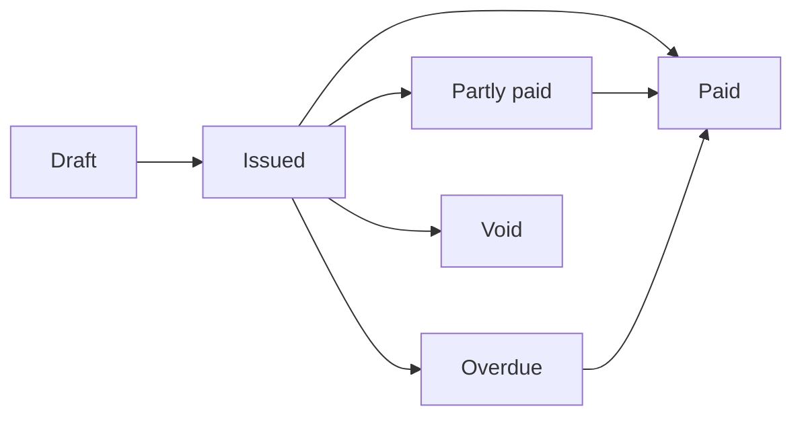

A few rules the app always follows:

- **Exact money.** Amounts are stored as whole numbers of fils or cents, never as decimals, so
  totals are always exact.
- **Separate businesses.** Every request is limited to your own business, and tests check that
  one business can't see another's data.
- **Safe numbering.** Invoice numbers are given out one at a time by the database, even when
  many invoices are issued at once.
- **No double payments.** If the payment provider sends the same notice twice, the second one is
  ignored.
- **Frozen exchange rates.** The rate is saved when an invoice is issued, so old reports never
  change.

## Tests

```bash
cd backend && ./mvnw verify    # backend tests, on a real database
cd frontend && npm run e2e     # browser tests (the API must be running)
```

GitHub Actions runs every test on each push.

## Deploy

```bash
cp infra/.env.prod.example infra/.env.prod   # fill in real passwords and keys
docker compose -f infra/docker-compose.prod.yml --env-file infra/.env.prod up -d --build
```

Only the website (port 3000) is public. Put HTTPS in front of it, and have that proxy set
`X-Real-IP` (Caddy and Nginx can): sign-in and sign-up limits are counted per visitor address.

Set `PAYMENTS_PROVIDER=stripe` with your Stripe keys. The test provider lets anyone with a
payment link mark an invoice paid, so the server won't start with it unless you also set
`PAYMENTS_MOCK_ENABLED=true`. Only do that for a public demo.

## Folders

```
backend/    the API and database migrations
frontend/   the website, browser tests and the sample data script
infra/      Docker files for local and production
docs/       screenshots and an example PDF
```

## What's next

- A score that warns about clients who often pay late
- The whole app in Arabic, not just the PDFs
- Local payment providers like Tap and PayTabs

## License

[MIT](LICENSE)
